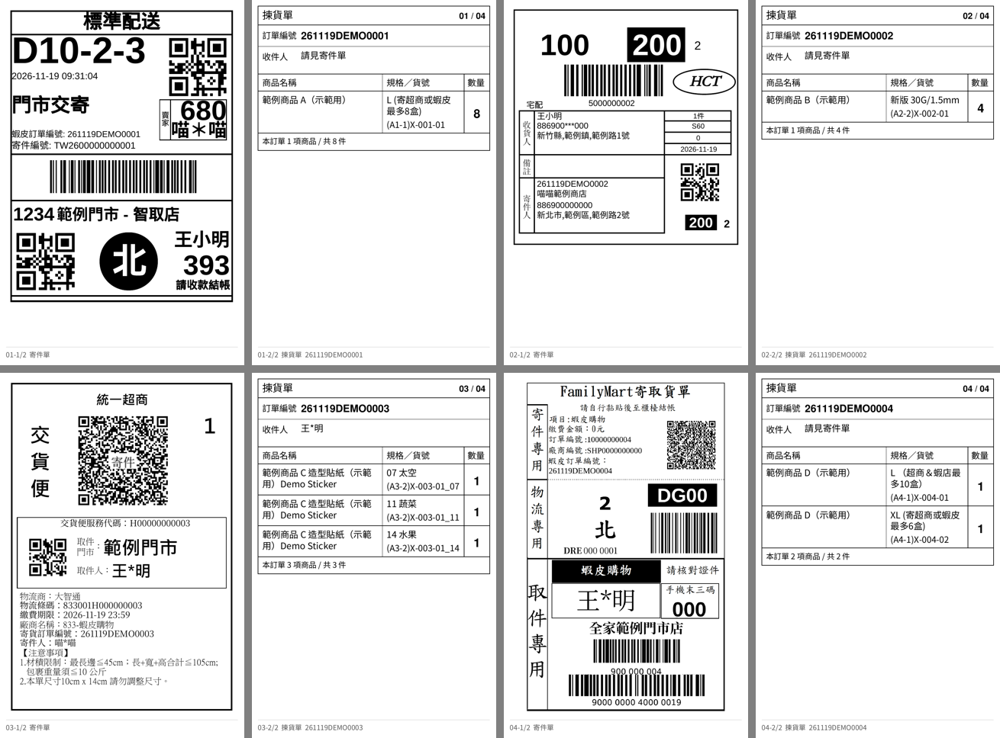

# 範例預期產出

這裡是把 [`samples/`](../samples/) 的 6 份範例 PDF 拖進蝦皮印單喵後，產生的**預期結果**，給大家對照用。

> ⚠️ 這些是工具產出的檔案，不是蝦皮原始出貨單。**請不要把這個資料夾的檔案拖進工具**，否則會出現錯誤。

| 檔案 | 內容 |
|---|---|
| [合成結果.pdf](合成結果.pdf) | 4 筆訂單、8 頁、共 17 件，每筆都是「寄件單 → 揀貨單」連續排列 |
| [preview.png](preview.png) | 8 頁的總覽圖 |

內容全是假資料，條碼和 QR Code 都是無效的假碼，請勿用於實際寄件。
