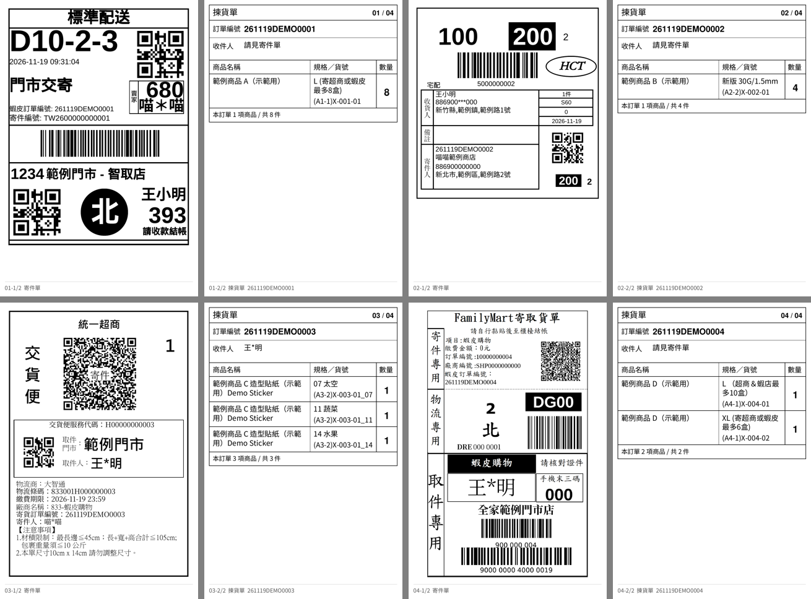

# 去識別化範例檔

這個資料夾是給大家試用「蝦皮印單喵」的**去識別化範例檔**，每種物流各一筆訂單，可以直接拖進工具測試。這個資料夾只放蝦皮原始格式的範例單，整個資料夾的 PDF 一起拖進去就可以。

> ⚠️ **檔案內容全是假資料。** 姓名、電話、地址、門市、訂單編號、物流編號、商品名稱和貨號都已經換掉。條碼和 QR Code 也重新產生過，裡面只有假值，掃描不會對應到任何真實包裹。**請勿用於實際寄件。**

## 檔案說明

| 檔案 | 物流 | 訂單編號 | 內容 |
|---|---|---|---|
| [店到店-寄件單+裝箱單.pdf](店到店-寄件單+裝箱單.pdf) | 蝦皮店到店 | 261119DEMO0001 | 寄件單和裝箱單在同一頁（合併檔） |
| [新竹物流-寄件單+裝箱單.pdf](新竹物流-寄件單+裝箱單.pdf) | 新竹物流（宅配） | 261119DEMO0002 | 寄件單和裝箱單在同一頁（合併檔） |
| [7-11-寄件單.pdf](7-11-寄件單.pdf) | 7-11 交貨便 | 261119DEMO0003 | 獨立 A4 寄件單 |
| [7-11-裝箱單.pdf](7-11-裝箱單.pdf) | 7-11 交貨便 | 261119DEMO0003 | 獨立裝箱單，3 項商品 |
| [全家-寄件單.pdf](全家-寄件單.pdf) | 全家 | 261119DEMO0004 | 四格（2×2）A4 圖片寄件單，用本機 OCR 辨識訂單編號 |
| [全家-裝箱單.pdf](全家-裝箱單.pdf) | 全家 | 261119DEMO0004 | 獨立裝箱單，2 項商品 |

## 試用步驟

1. 下載上面 6 份範例 PDF（點檔名後按右上角的下載按鈕）。
2. 開啟蝦皮印單喵，把 6 份 PDF **一起**拖進「出貨文件 PDF」區域。
3. 按「產生出貨標籤」。

## 預期結果

- 畫面顯示 **4 筆訂單、8 頁**，共 17 件。
- 每筆訂單都是「寄件單 → 揀貨單」連續排列，順序是店到店、新竹物流、7-11、全家。
- 下載的 `合成結果.pdf` 應該和 [sample-output/合成結果.pdf](../sample-output/合成結果.pdf) 一致，也可以看下面的總覽圖對照。
- ⚠️ `sample-output/` 裡的合成結果是工具產出的檔案，**不是蝦皮原始單，請不要拖進工具**，否則會出現錯誤。

## 注意事項

- 這些檔案是把真實出貨文件去識別化後做成的，版面和真實文件相同，但**所有資料都是虛構的**。
- 條碼和 QR Code 都是無效的假碼，不能拿去寄件、取件或查詢。
- 全家的訂單編號要靠本機 OCR 辨識，第一次辨識需要幾秒鐘。
